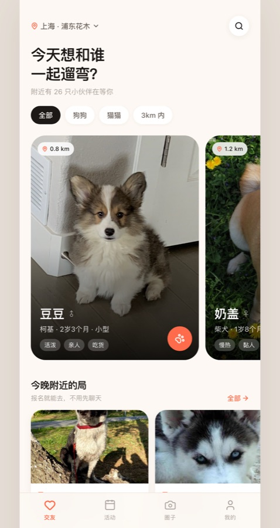
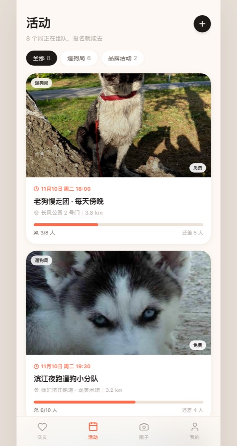
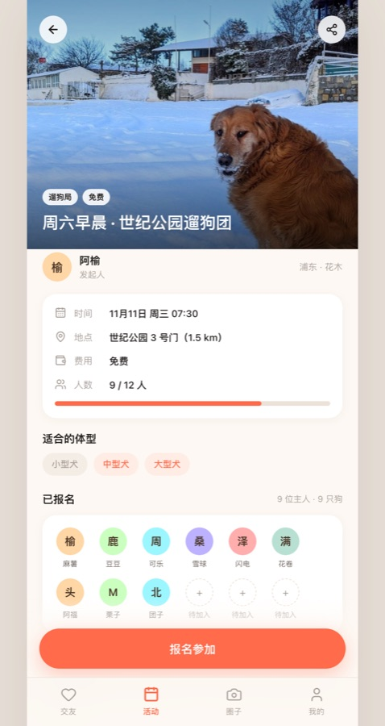
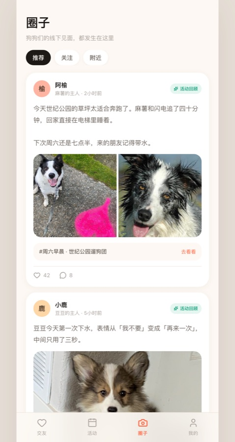
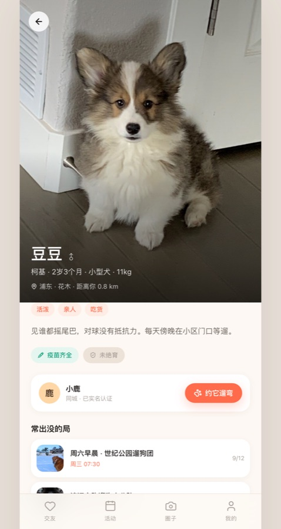

<div align="center">



# 🐾 遛遛 · 同城遛狗局

**给城市里独自遛狗的年轻人，找一个今晚就能一起遛狗的邻居。**


### [🔗 在线体验 →](https://pet-link-kohl.vercel.app)

<sub>建议用手机打开，或把浏览器窗口缩窄到手机宽度</sub>

[产品方案](docs/产品方案.md) · [部署指南](docs/部署指南.md)

</div>

---

## 这是什么

一个**移动端优先**的宠物社交 Web 应用。养宠人可以给宠物建档案、刷到附近的小伙伴、报名参加同城的遛狗局，也可以自己发起一个局，让今晚遛狗不再是一个人。

不是"宠物版的探探"，而是一个更具体的动作：**今晚、附近、一起遛狗。**

> 这是一个作品集项目，不是商业产品。目标是把一个完整的产品循环跑通、讲清楚背后的决策，而不是追求用户量。

## 为什么是「活动」，不是「匹配」

原始想法有三个：宠物交友、线下聚会、宠物品牌活动。直接做三个功能，两周做不完，而且每个都浅。

把它们拆开看会发现：**这不是三个功能，是三层。**

| 原始想法 | 落地形态 | 代价 |
|---|---|---|
| 宠物交友 | 首页附近宠物卡片流 + 打招呼 | 中 |
| 线下宠物聚会 | 「遛狗局」发起 / 报名 | 中 |
| 宠物品牌活动 | **同一个活动模型**加个 `品牌` 标签 + 认证徽章 | ≈ 0 |

关键判断是**先做活动，后做一对一匹配**：

- 一对一匹配需要**双边成立**——两个人互相看对眼才有下文。没有用户就没有匹配，没有匹配就没人来，冷启动直接锁死。
- 活动是**单边成立**的——有 1 个人发起，页面就有内容可看，其他人只需要决定"去不去"。

现实里大家约遛狗本来也不是一对一私聊，而是拉个群、约个时间地点。所以"遛狗局"既是最小可行的功能，也恰好是最符合真实行为的那一个。

## 功能

| 模块 | 能力 |
|---|---|
| **交友** | 附近宠物卡片横滑、按猫/狗/距离筛选、打招呼 |
| **宠物主页** | 品种体重年龄、性格标签、疫苗与绝育状态、主人信息、常出没的局 |
| **活动** | 遛狗局 / 品牌活动分类、报名进度条、地点距离 |
| **活动详情** | 时间地点费用、已报名头像、体型限制、报名与取消 |
| **发起活动** | 填写标题时间地点和说明，发布后立刻出现在列表里 |
| **圈子** | 图文动态、点赞、动态关联到具体活动，形成「活动 → 回顾」的闭环 |
| **我的** | 我的宠物、我报名的局、数据统计 |

种子数据：**26 只宠物、8 个活动（6 个遛狗局 + 2 个品牌活动）、12 条动态**。

## 界面

<table>
  <tr>
    <td align="center"><br /><sub>活动列表 · 报名进度</sub></td>
    <td align="center"><br /><sub>活动详情 · 体型限制与已报名</sub></td>
  </tr>
  <tr>
    <td align="center"><br /><sub>圈子 · 活动回顾</sub></td>
    <td align="center"><br /><sub>宠物主页</sub></td>
  </tr>
</table>

## 技术栈

| 层 | 选型 | 为什么 |
|---|---|---|
| 框架 | Next.js 16（App Router） | 路由、构建、部署一条龙，Vercel 原生支持 |
| UI | React 19 + TypeScript | 类型让 AI 辅助写代码时出错更少 |
| 样式 | Tailwind CSS 4 | 设计变量集中在一处，改主色只改一个值 |
| 图标 | lucide-react | 风格统一，体积小 |
| 数据 | 本地种子数据 + React Context | 先跑通体验，后端留到第二期 |

**没有后端、没有数据库、没有登录。** 这是刻意的取舍，见下方「已知边界」。

## 本地运行

需要 Node.js 20.9+。

```bash
npm install
npm run dev
```

打开 <http://localhost:3000>，用浏览器的**手机模拟视图**看效果最好（Chrome DevTools → Toggle device toolbar）。

> macOS 用户也可以直接双击 `启动.command`，会用项目内置的便携版 Node 启动。

生产构建：

```bash
npm run build && npm start
```

## 目录结构

```
.
├── src/
│   ├── app/                  # 页面（Next.js App Router）
│   │   ├── page.tsx          # 交友 · 首页
│   │   ├── pets/[id]/        # 宠物主页
│   │   ├── meetups/          # 活动列表 / 详情 / 发起
│   │   ├── feed/             # 圈子
│   │   └── me/               # 我的
│   ├── components/           # TabBar、Avatar、全局状态
│   └── lib/
│       ├── data.ts           # 种子数据 ← 想改内容改这里
│       ├── types.ts          # 数据结构
│       └── date.ts           # 日期格式化
├── public/img/               # 26 张宠物照片（本地存储，不依赖外链）
└── docs/
    ├── 产品方案.md            # 定位、功能清单、数据模型、迭代计划
    └── 部署指南.md
```

## 已知边界

这一版是**可演示的原型**，不是可运营的产品：

- **没有后端**：报名、打招呼、点赞、发起活动都存在浏览器内存里，**刷新即重置**
- **没有真实登录**：默认你是「小鹿」，你的狗是「豆豆」
- **时间是相对今天生成的**：所以活动永远显示在几天后，演示不会过期
- **照片是公开素材**：来自 dog.ceo / TheCatAPI 的公开图片，按品种挑选，仅用于演示
- **图片已按品种对齐**：每只宠物的照片和它的品种一致，且 34 张图互不重复

## Roadmap

- [ ] 接 Supabase：真实注册登录、数据库、图片上传
- [ ] 地图找局：高德 JS API，按距离排序活动
- [ ] 报名后解锁群聊，替代现在的"报名后加联系方式"
- [ ] 品牌方后台：商家自己发活动、看报名数据
- [x] 部署到 Vercel —— [pet-link-kohl.vercel.app](https://pet-link-kohl.vercel.app)
- [ ] 绑定自定义域名

## 几个技术上的坑

**`transform` 会让 `fixed` 子元素错位。** 页面进场动画最初用了 `translateY`，结果活动详情页底部的「报名」悬浮按钮直接飞出屏幕——因为带 `transform` 的祖先会成为 `fixed` 后代的定位参照。最后把进场动画改成纯 `opacity`，问题消失。

**种子数据必须"看起来像真的"。** 社交产品最怕打开是空的。26 只宠物、8 个活动、12 条动态不是装饰，是让冷启动问题在演示阶段被绕开的必要手段——同时也正好是面试时能讲的一个产品话题。

**日期不能用 `new Date()` 直接格式化。** 服务器（UTC）和浏览器（+08:00）会因为时区差导致水合不一致。所以时间统一按 `Asia/Shanghai` 生成 ISO 字符串，再从字符串切片格式化，两端结果完全一致。

## License

MIT
